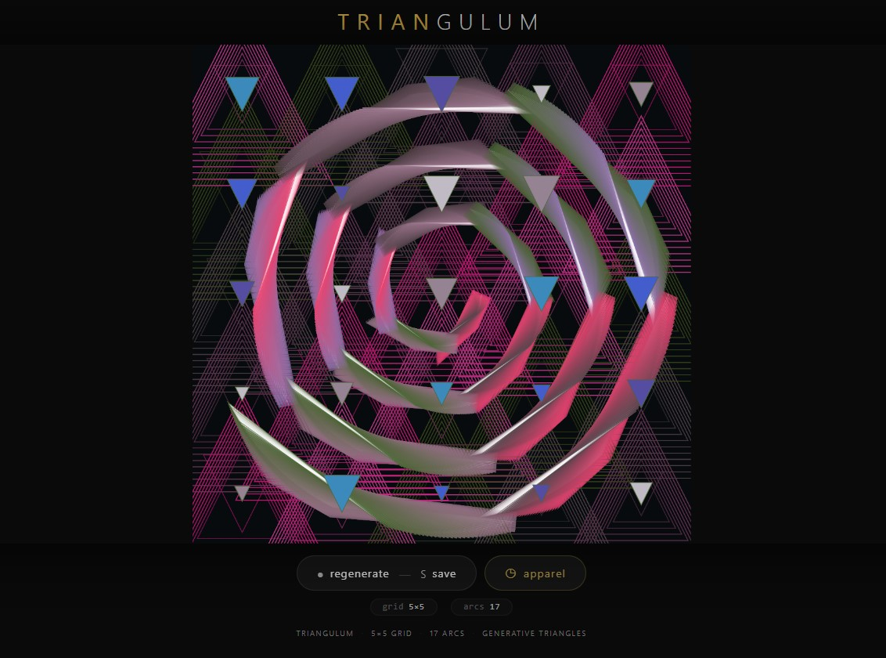
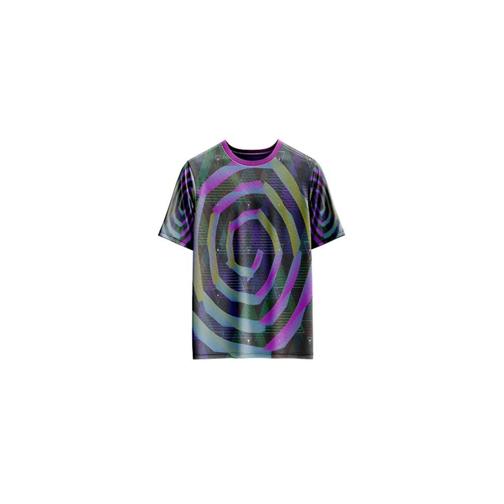

# Triangulum — Generative Art

[](https://reyrove.github.io/Triangulum-Generative-Art)
[](https://opensource.org/licenses/MIT)

> **Generative triangle art with celestial aesthetics.** Each refresh creates a cosmic landscape of magical triangles, glowing planets, frost particles, and arc patterns arranged in a 5×5 grid.

## 🎨 Live Demo

<div align="center">
  <a href="https://reyrove.github.io/Triangulum-Generative-Art" target="_blank">
    
  </a>
  <br><br>
  <a href="https://reyrove.github.io/Triangulum-Generative-Art" target="_blank">
    
  </a>
  <br>
  <em>Click the image or button to experience the generative art</em>
</div>

## 👕 Apparel Preview

<div align="center">
  
  <br>
  <em>Triangulum artwork printed on a T-shirt</em>
</div>

## ✨ Features

- **Celestial Theme** — Cosmic colors and magical atmosphere
- **5×5 Grid** — 25 positions for planets, frost particles, and magical triangles
- **17 Arcs** — Rotating triangular arc patterns
- **Dynamic Colors** — Randomly generated color palettes
- **Glow Effects** — Radial gradients and glow layers
- **Animated** — Continuous rotation and pulsation
- **Save & Share** — Download as PNG
- **Apparel Mode** — Preview artwork on a T-shirt mockup
- **Responsive** — Works on desktop, tablet, and mobile
- **p5.js Powered** — Built with the creative coding library
- **Keyboard Shortcuts**:
  - `R` — Regenerate
  - `S` — Save image
  - `T` — Toggle apparel view
  - `Space` — Regenerate

## 🎨 Artwork Details

| Parameter | Value | Description |
|-----------|-------|-------------|
| **Grid Size** | 5×5 | 25 positions total |
| **Arc Count** | 17 | Rotating triangular arcs |
| **Planets** | 25 | Glowing celestial bodies |
| **Frost Particles** | 25 | Delicate ice crystals |
| **Magical Triangles** | 25 | Gradient-filled triangles |

## 🎯 Visual Elements

### Magical Arcs
- 17 rotating arcs arranged in concentric circles
- Each arc is composed of 32 triangular segments
- Gradient colors transition across each arc
- Glowing stroke effects create depth

### Planets
- 25 glowing planets in a 5×5 grid
- Radial gradient fills
- Glow layers create luminous halos
- Pulsating sizes add life

### Frost Particles
- 25 delicate ice crystals
- Translucent white triangles
- Random sizes and opacities
- Scattered across the grid

### Magical Triangles
- 25 gradient-filled triangles
- Random sizes and positions
- Star-like color palette
- Radial gradient fills

## 🚀 Quick Start

### Local Development

```bash
# Clone the repository
git clone https://github.com/reyrove/Triangulum-Generative-Art.git

# Navigate to the directory
cd Triangulum-Generative-Art

# Open in browser
open index.html
# or use a live server
```

### Deploy to GitHub Pages

1. Push to GitHub
2. Go to Settings → Pages
3. Select branch `main` and root folder
4. Your site will be live at `https://reyrove.github.io/Triangulum-Generative-Art`

## 🧠 How It Works

The artwork creates a cosmic triangle-based landscape:

1. **Setup**:
   - Random color palettes for arcs, stars, and planets
   - 5×5 grid positions calculated
   - Frost particles, planets, and magical triangles placed

2. **Rendering**:
   - Background with random dark/translucent color
   - Planets drawn with glow effects
   - 17 rotating arcs with triangular segments
   - Frost particles and magical triangles overlaid

3. **Animation**:
   - Continuous rotation of arc patterns
   - Pulsating planet sizes
   - Dynamic color shifts
   - Always evolving visual experience

## 📁 File Structure

```
Triangulum-Generative-Art/
├── index.html          # Main application (all-in-one)
├── Triangulum.jpg      # T-shirt mockup image
├── fav.svg             # Favicon
├── demo-screenshot.jpg # Website demo screenshot
├── README.md           # This file
└── LICENSE             # MIT License
```

## 🛠️ Tech Stack

- **p5.js** — Creative coding library
- **Canvas API** — 2D rendering with gradients
- **CSS Flexbox/Grid** — Responsive layout
- **GitHub Pages** — Hosting

## 🎯 Interactive Controls

| Action | Keyboard | Button |
|--------|----------|--------|
| Regenerate | `R` or `Space` | Click "regenerate" |
| Save Image | `S` | Click "regenerate" |
| Toggle Apparel | `T` | Click "apparel" |

## 🎨 The Creative Process

### Triangular Architecture
Every element in the artwork is built from triangles. From the arc segments to the planets and frost particles, triangles form the fundamental visual language.

### Celestial Color Palette
Colors are generated with cosmic inspiration—deep purples, vibrant magentas, icy blues, and warm golds. Each refresh produces a unique color world.

### Layered Depth
Multiple visual layers create depth:
1. Background with subtle transparency
2. Glowing planets with radial gradients
3. Rotating arc patterns
4. Frost particles and magical triangles

### Continuous Evolution
The artwork animates continuously, with arcs rotating and planets pulsating, creating a living, breathing cosmic scene.

## 📱 Responsive Design

The application automatically adapts to:
- Desktop screens
- Tablets
- Mobile phones
- Landscape orientation
- Various aspect ratios
- Small screens (down to 380px wide)

## 🤝 Contributing

Contributions are welcome! Feel free to:
- Fork the repository
- Create a feature branch
- Submit a pull request

### Ideas for Contributions:
- Additional grid sizes
- New triangle patterns
- Interactive controls
- Color palette presets
- Performance optimizations
- More apparel mockups

## 📄 License

MIT License — see [LICENSE](LICENSE) file for details.

## 🙏 Acknowledgments

- Created with p5.js
- Inspired by celestial patterns and triangular geometry
- Special thanks to the creative coding community

---

**Built with ❤️ and triangular dreams**